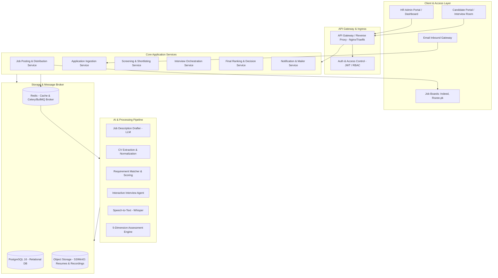

# System Architecture Document: AutoHR

AutoHR is an automated, AI-driven end-to-end recruitment platform designed to streamline hiring from job specification to candidate ranking across 4 distinct phases and 10 sequential workflow steps.

---

## 1. High-Level Architecture Overview

AutoHR follows a modular, microservices/event-driven modular monolith architecture capable of asynchronous AI processing (CV parsing, scoring, live audio/video interview analysis, and transcription).



---

## 2. 4 Phases & 10 Steps Pipeline Architecture

```mermaid
sequenceDiagram
    autonumber
    actor HR as HR Team
    participant App as AutoHR Core
    participant AI as AI Engine
    participant Ext as External Channels (Indeed / Rozee.pk)
    actor Can as Candidate

    %% Phase 1
    rect rgb(240, 248, 255)
    Note over HR, Ext: Phase 1: Post
    HR->>App: 1. Input Role details (Title, Skills, Exp, Salary, Hires)
    App->>AI: Generate draft Job Description
    AI-->>App: Draft JD
    App-->>HR: 2. Present JD for Review & Approval
    HR->>App: Approve JD
    App->>Ext: 3. Publish to Indeed & Rozee.pk
    end

    %% Phase 2
    rect rgb(245, 255, 250)
    Note over Ext, Can: Phase 2: Screen
    Ext-->>App: 4. Ingest Application (Email / Web Form)
    Can-->>App: Submit CV directly via Web Form
    App->>AI: 5. Parse CV & Score against Job Requirements
    AI-->>App: Structured Data & CV Match Score
    App->>App: 6. Shortlist Top N Candidates
    App->>Can: Send rejection to unshortlisted candidates
    App->>Can: Send interview invitation to shortlisted candidates
    end

    %% Phase 3
    rect rgb(255, 250, 240)
    Note over HR, Can: Phase 3: Interview
    Can->>App: 7. Select Time Slot & Submit Recording Consent
    App->>Can: 8. Launch 3-Stage AI Interview (Screening -> Tech -> Behavioral)
    Can->>App: Video / Audio responses streamed & saved
    App->>AI: 9. Transcribe & Score on 5 parameters (out of 10)
    AI-->>App: Dimension scores & Answer rationale
    end

    %% Phase 4
    rect rgb(255, 240, 245)
    Note over HR, Can: Phase 4: Decide
    App->>AI: Combine CV Score + Interview Scores
    AI-->>App: 10. Generate Final Ranked List & Justification
    App-->>HR: Present Decision Dashboard
    App->>App: Retain recordings for Top-Ranked; Purge/Archive rest
    end
```

---

## 3. Detailed Component Breakdown

### Phase 1: Post

#### Step 1: Job Input
- **Components**: Form UI with schema validation (Zod / Pydantic).
- **Inputs**: Role Title, Required Skills (core vs bonus), Years of Experience, Salary Range (Min-Max, Currency), Number of Openings (`target_hires`).
- **Storage**: Initial row created in `job_postings` with status `draft`.

#### Step 2: AI Job Description Generation
- **Components**: Prompt Template Engine + LLM (e.g., GPT-4o / Claude 3.5 Sonnet / LLaMA 3).
- **Behavior**: Generates professional, inclusive JDs detailing company context, responsibilities, role expectations, and benefits.
- **Human-in-the-Loop**: The drafted JD enters `pending_approval` state. HR can edit markdown/rich-text. Once HR submits approval, state transitions to `approved`.

#### Step 3: Multi-Platform Posting
- **Components**: Multi-board Publishing Worker (Adapter Pattern).
  - `IndeedPublisher`: Uses Indeed Employer API / XML feed / sponsored posting endpoint.
  - `RozeePublisher`: Uses Rozee.pk API / automation adapter.
  - `BasePublisher`: Interface for future boards (LinkedIn, Bayt, etc.).
- **Resilience**: Asynchronous task with exponential backoff and webhook callbacks for application attribution.

---

### Phase 2: Screen

#### Step 4: Application Collection
- **Ingestion Channels**:
  1. **Dedicated Inbound Email**: Inbound email webhook (SendGrid Inbound Parse / AWS SES / Mailgun) parses incoming emails, extracts candidate details, and downloads CV attachments (PDF, DOCX).
  2. **Hosted Online Application Form**: Mobile-responsive branded career page hosted per job posting.
- **Storage**: Raw resumes stored in S3/MinIO bucket with presigned URLs. Metadata saved to `applications`.

#### Step 5: AI CV Screening
- **Components**: 
  1. **Document Extractor**: PDF/DOCX parser (PyPDF, pdfplumber, python-docx, OCR fallback via Tesseract/AWS Textract).
  2. **CV Parser LLM**: Normalizes raw text into structured JSON (Contact info, work experience timeline, verified skills, education, certifications).
  3. **Scoring Agent**: Evaluates parsed profile against approved job requirements.
- **Scoring Dimensions**:
  - Skill coverage (Hard & Soft skills match)
  - Experience relevance (Domain, seniority, years)
  - Educational background
- **Output**: Generates a normalized score (0–100) and an explainable breakdown stored in `cv_evaluations`.

#### Step 6: Shortlist and Notify
- **Shortlist Mechanism**: For a job with $N$ requested hires, HR configures shortlisting threshold $K$ (e.g., top $K$ or top $M \times N$ candidates).
- **Batch Processing**:
  - Status updated to `shortlisted` for top candidates.
  - Status updated to `rejected` for remainder.
- **Automated Mailer**:
  - Shortlisted candidates receive an email with a unique magic scheduling token.
  - Rejected candidates receive a polite, branded rejection email.

---

### Phase 3: Interview

#### Step 7: Schedule & Consent
- **Scheduling**: Candidate opens magic link, views available dynamic time slots, and books an interview.
- **Consent Gate (Mandatory)**: Candidate must check explicit consent terms:
  - Video & Audio recording acknowledgement.
  - AI automated processing and biometric analysis notice.
  - Consent timestamp, IP address, and acceptance flag are persisted in `interview_consents`. If consent is withheld, interview cannot commence.

#### Step 8: AI Interview Execution
- **Architecture**: WebRTC / LiveKit / Daily.co audio-video session with dynamic question generation and interactive conversational pacing.
- **3-Stage Sequential Execution**:
  1. **Stage 1 - Screening (5–10 mins)**: Icebreaker, background overview, motivation, career trajectory.
  2. **Stage 2 - Technical (15–20 mins)**: Role-specific technical challenges, scenarios, edge cases, system/domain problem solving.
  3. **Stage 3 - Behavioral (10–15 mins)**: STAR framework questions (Situation, Task, Action, Result), team dynamics, conflict resolution, culture fit.
- **Recording Engine**: Streams captured and stored securely in Object Storage in chunks (`.webm` / `.mp4`).

#### Step 9: Interview Analysis & Multi-Dimensional Scoring
- **Transcription**: Audio tracks processed with Whisper (local or API) with speaker diarization and timestamping.
- **Evaluation Dimensions (Each scored 0–10)**:
  1. **Communication**: Articulation, clarity, brevity, structure.
  2. **Confidence**: Decisiveness, tone steadiness, fluency, composure.
  3. **Technical Knowledge**: Depth, accuracy, best practices, conceptual clarity.
  4. **Relevance**: Direct answer to the prompt without evasiveness.
  5. **Problem-Solving**: Critical thinking, analytical structure, handling hypothetical edge cases.
- **Storage**: Persisted per answer and aggregated into `interview_evaluations`.

---

### Phase 4: Decide

#### Step 10: Final Ranking, Reporting & Retention
- **Ranking Engine**:
  - Computes composite weighted score:
    $$\text{Final Score} = (\text{CV Score} \times W_{CV}) + (\text{Interview Score} \times W_{INT})$$
    *(Default: $W_{CV} = 0.35, W_{INT} = 0.65$, configurable per role).*
- **Executive Summary Agent**: Synthesizes full candidate journey into an executive summary highlighting:
  - Key strengths
  - Red flags / risks
  - Recommended hire recommendation (Strong Hire / Hire / Lean Hire / No Hire)
- **HR Dashboard**:
  - Interactive leaderboard with sortable columns.
  - Drill-down into transcript snippets, AI rationale, and video playback.
- **Storage Retention Policy Worker**:
  - Automatically preserves video and audio recordings **only** for Top $N$ candidates (where $N = \text{target\_hires} \times \text{buffer}$).
  - Automatically deletes/purges raw media streams of non-selected candidates after a 14-day appeal window to optimize S3 storage costs and honor GDPR/Data Privacy compliance. Transcripts and scores are retained.

---

## 4. Technology Stack Recommendations

| Layer | Recommended Technology | Rationale |
| :--- | :--- | :--- |
| **Frontend** | React / Next.js, TypeScript, TailwindCSS, Lucide Icons | Responsive HR dashboard & candidate interview interface |
| **Backend API** | FastAPI (Python) or NestJS (Node.js) | FastAPI pairs natively with AI libraries (Pydantic, LangChain, Celery) |
| **Database** | PostgreSQL 16 | ACID compliant, strong JSONB capabilities, pgvector for semantic skill matching |
| **Cache & Queue** | Redis + Celery / BullMQ | Background scheduling, batch CV parsing, audio transcription jobs |
| **Object Storage** | AWS S3 or MinIO | Secure storage for CVs, audio/video recordings |
| **AI / LLM** | OpenAI GPT-4o / Anthropic Claude / Whisper | High-accuracy parsing, reasoning, transcription, and interview dialogue |
| **Realtime Audio/Video** | WebRTC via LiveKit or Daily.co | Low-latency audio/video streaming and recording |
| **Email Gateway** | Resend / SendGrid / Postmark | Reliable delivery for invites and automated rejections |

---

## 5. Phased Build Order Strategy

To ensure rapid time-to-value and a demonstrable product as early as possible, the project is structured into three progressive milestones:

```
[Milestone 1: Steps 1 - 6]  ---> Working Screening & Applicant System (Demonstrable MVP)
[Milestone 2: Steps 7 - 9]  ---> Automated AI Interview & Scoring Engine
[Milestone 3: Step 10]      ---> Combined Decision Dashboard & Retention Cleanup
```

1. **Milestone 1 (Steps 1–6) - The Core Funnel & Screening Engine**:
   - Build Job Creation, AI JD generation, and Approval UI.
   - Build Job Board publishing adapters (Indeed & Rozee.pk).
   - Build Application collection (inbox & public form).
   - Implement CV parsing and AI Scoring against job specs.
   - Implement Shortlisting logic & automated email dispatches.
   - *Deliverable: End-to-end recruitment funnel from posting to shortlisted candidates.*

2. **Milestone 2 (Steps 7–9) - The Interactive Interview & Analysis Engine**:
   - Implement candidate booking calendar & mandatory consent recording gate.
   - Build the 3-stage conversational AI interview agent with video/audio capture.
   - Build Whisper transcription pipeline.
   - Build the 5-dimension scoring engine (0–10 on Communication, Confidence, Tech, Relevance, Problem-Solving).
   - *Deliverable: Fully automated interactive interview and transcription evaluation system.*

3. **Milestone 3 (Step 10) - Decision Engine, HR Dashboard & Lifecycle**:
   - Compute aggregate weighted rankings.
   - Build HR Decision Dashboard with AI rationale and candidate drilldown.
   - Implement automated media retention and cleanup policies.
   - *Deliverable: Production-ready automated HR recruitment platform.*
