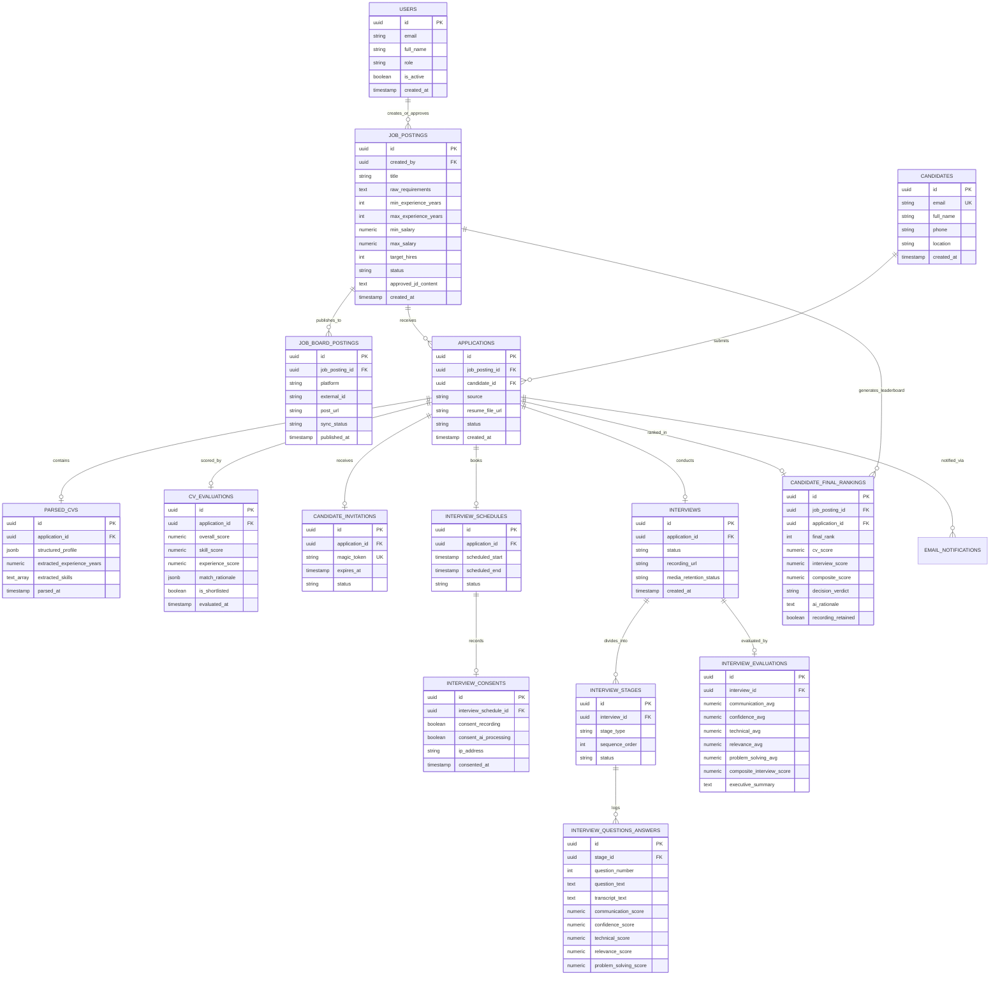

# Database Architecture Document: AutoHR (PostgreSQL)

This document specifies the relational database schema, indexing strategies, data integrity constraints, and lifecycle policies for **AutoHR** using **PostgreSQL 16**.

---

## 1. Database Architecture & Design Principles

1. **Primary Keys**: UUIDv4 (`gen_random_uuid()`) for distributed resilience, security against enumeration attacks, and multi-tenant portability.
2. **Naming Conventions**: `snake_case` for all table names, column names, constraints, and indexes. Plural table names (e.g., `job_postings`, `applications`).
3. **Auditability & Temporal Tracking**: Every primary table includes `created_at` (default `CURRENT_TIMESTAMP`) and `updated_at`.
4. **Structured & Semi-Structured Data Balance**:
   - Relational columns for high-frequency queries, joins, and filtering (status flags, scores, ranks, foreign keys).
   - `JSONB` for unstructured and semi-structured AI payloads (raw parsed CV structures, rubric breakdowns, question logs).
5. **Data Retention & Privacy Compliance (GDPR / Sensitive Media)**:
   - Resumes, transcripts, and evaluation metrics are preserved.
   - Heavy media artifacts (interview video and audio streams) have explicit retention flags and scheduled automated purging for non-top candidates.

---

## 2. Entity-Relationship Diagram (ERD)



---

## 3. PostgreSQL Extensions & Custom Types (Enums)

```sql
-- Required Extensions
CREATE EXTENSION IF NOT EXISTS "pgcrypto";       -- For gen_random_uuid()
CREATE EXTENSION IF NOT EXISTS "citext";         -- Case-insensitive emails

-- Custom Enumerations
CREATE TYPE user_role_enum AS ENUM ('admin', 'hr_manager', 'interviewer');

CREATE TYPE job_status_enum AS ENUM (
    'draft',
    'pending_approval',
    'approved',
    'published',
    'paused',
    'closed'
);

CREATE TYPE job_board_platform_enum AS ENUM (
    'indeed',
    'rozee_pk',
    'linkedin',
    'custom_career_page'
);

CREATE TYPE board_sync_status_enum AS ENUM (
    'pending',
    'published',
    'failed',
    'expired'
);

CREATE TYPE application_source_enum AS ENUM (
    'email_inbound',
    'web_form',
    'indeed',
    'rozee_pk',
    'manual_upload'
);

CREATE TYPE application_status_enum AS ENUM (
    'applied',
    'parsing_cv',
    'screened',
    'shortlisted',
    'rejected',
    'interview_invited',
    'interview_scheduled',
    'interview_in_progress',
    'interview_completed',
    'final_review',
    'hired',
    'archived'
);

CREATE TYPE interview_stage_type_enum AS ENUM (
    'screening',
    'technical',
    'behavioral'
);

CREATE TYPE stage_status_enum AS ENUM (
    'not_started',
    'in_progress',
    'completed',
    'skipped'
);

CREATE TYPE media_retention_enum AS ENUM (
    'active',
    'marked_for_deletion',
    'purged'
);

CREATE TYPE decision_verdict_enum AS ENUM (
    'strong_hire',
    'hire',
    'lean_hire',
    'no_hire'
);

CREATE TYPE notification_type_enum AS ENUM (
    'rejection',
    'interview_invite',
    'interview_reminder',
    'hr_status_update'
);
```

---

## 4. Complete Table Schemas (DDL)

### 4.1 Phase 1 Tables: Job Creation & Board Distribution

#### `users`
Tracks internal HR professionals and administrators.
```sql
CREATE TABLE users (
    id UUID PRIMARY KEY DEFAULT gen_random_uuid(),
    email CITEXT UNIQUE NOT NULL,
    full_name VARCHAR(150) NOT NULL,
    password_hash VARCHAR(255) NOT NULL,
    role user_role_enum NOT NULL DEFAULT 'hr_manager',
    is_active BOOLEAN NOT NULL DEFAULT TRUE,
    created_at TIMESTAMPTZ NOT NULL DEFAULT CURRENT_TIMESTAMP,
    updated_at TIMESTAMPTZ NOT NULL DEFAULT CURRENT_TIMESTAMP
);
```

#### `job_postings`
Stores job requirements, AI-generated JD, and target parameters.
```sql
CREATE TABLE job_postings (
    id UUID PRIMARY KEY DEFAULT gen_random_uuid(),
    created_by UUID NOT NULL REFERENCES users(id) ON DELETE RESTRICT,
    approved_by UUID REFERENCES users(id) ON DELETE SET NULL,
    
    -- Step 1: Input parameters
    title VARCHAR(200) NOT NULL,
    min_experience_years INT NOT NULL CHECK (min_experience_years >= 0),
    max_experience_years INT CHECK (max_experience_years >= min_experience_years),
    min_salary NUMERIC(12, 2) CHECK (min_salary >= 0),
    max_salary NUMERIC(12, 2) CHECK (max_salary >= min_salary),
    currency VARCHAR(3) NOT NULL DEFAULT 'USD',
    target_hires INT NOT NULL DEFAULT 1 CHECK (target_hires > 0),
    shortlist_multiplier NUMERIC(4, 2) NOT NULL DEFAULT 3.0 CHECK (shortlist_multiplier >= 1.0),
    required_skills TEXT[] NOT NULL DEFAULT '{}',
    bonus_skills TEXT[] NOT NULL DEFAULT '{}',
    
    -- Step 2: AI JD Generation & Review
    ai_jd_prompt_payload JSONB,
    ai_generated_jd_draft TEXT,
    approved_jd_content TEXT,
    status job_status_enum NOT NULL DEFAULT 'draft',
    approved_at TIMESTAMPTZ,
    
    created_at TIMESTAMPTZ NOT NULL DEFAULT CURRENT_TIMESTAMP,
    updated_at TIMESTAMPTZ NOT NULL DEFAULT CURRENT_TIMESTAMP
);
```

#### `job_board_postings`
Tracks Step 3 multi-platform syndication to Indeed, Rozee.pk, etc.
```sql
CREATE TABLE job_board_postings (
    id UUID PRIMARY KEY DEFAULT gen_random_uuid(),
    job_posting_id UUID NOT NULL REFERENCES job_postings(id) ON DELETE CASCADE,
    platform job_board_platform_enum NOT NULL,
    external_job_id VARCHAR(255),
    post_url TEXT,
    sync_status board_sync_status_enum NOT NULL DEFAULT 'pending',
    response_payload JSONB,
    error_message TEXT,
    published_at TIMESTAMPTZ,
    expires_at TIMESTAMPTZ,
    created_at TIMESTAMPTZ NOT NULL DEFAULT CURRENT_TIMESTAMP,
    updated_at TIMESTAMPTZ NOT NULL DEFAULT CURRENT_TIMESTAMP,
    
    CONSTRAINT uq_job_platform UNIQUE(job_posting_id, platform)
);
```

---

### 4.2 Phase 2 Tables: Ingestion, CV Parsing & AI Screening

#### `candidates`
Stores candidate profile information across multiple applications.
```sql
CREATE TABLE candidates (
    id UUID PRIMARY KEY DEFAULT gen_random_uuid(),
    email CITEXT UNIQUE NOT NULL,
    full_name VARCHAR(200) NOT NULL,
    phone VARCHAR(50),
    linkedin_url TEXT,
    location VARCHAR(150),
    created_at TIMESTAMPTZ NOT NULL DEFAULT CURRENT_TIMESTAMP,
    updated_at TIMESTAMPTZ NOT NULL DEFAULT CURRENT_TIMESTAMP
);
```

#### `applications`
Step 4 applications arriving from email inboxes or online forms.
```sql
CREATE TABLE applications (
    id UUID PRIMARY KEY DEFAULT gen_random_uuid(),
    job_posting_id UUID NOT NULL REFERENCES job_postings(id) ON DELETE CASCADE,
    candidate_id UUID NOT NULL REFERENCES candidates(id) ON DELETE CASCADE,
    source application_source_enum NOT NULL DEFAULT 'web_form',
    source_message_id VARCHAR(255),               -- Inbound email Message-ID if applicable
    resume_file_url TEXT NOT NULL,                 -- S3 Object path
    resume_original_filename VARCHAR(255) NOT NULL,
    resume_mime_type VARCHAR(100) NOT NULL,
    status application_status_enum NOT NULL DEFAULT 'applied',
    created_at TIMESTAMPTZ NOT NULL DEFAULT CURRENT_TIMESTAMP,
    updated_at TIMESTAMPTZ NOT NULL DEFAULT CURRENT_TIMESTAMP,

    CONSTRAINT uq_job_candidate UNIQUE(job_posting_id, candidate_id)
);
```

#### `parsed_cvs`
Step 5 parsed data extracted from the candidate's CV document.
```sql
CREATE TABLE parsed_cvs (
    id UUID PRIMARY KEY DEFAULT gen_random_uuid(),
    application_id UUID UNIQUE NOT NULL REFERENCES applications(id) ON DELETE CASCADE,
    raw_text TEXT NOT NULL,
    structured_profile JSONB NOT NULL,             -- Education, Work History, Certifications
    extracted_skills TEXT[] NOT NULL DEFAULT '{}',
    extracted_experience_years NUMERIC(4, 1),
    highest_degree VARCHAR(150),
    parsing_model VARCHAR(100) NOT NULL,
    parsed_at TIMESTAMPTZ NOT NULL DEFAULT CURRENT_TIMESTAMP
);
```

#### `cv_evaluations`
Step 5 scoring output against the approved job posting specifications.
```sql
CREATE TABLE cv_evaluations (
    id UUID PRIMARY KEY DEFAULT gen_random_uuid(),
    application_id UUID UNIQUE NOT NULL REFERENCES applications(id) ON DELETE CASCADE,
    
    overall_score NUMERIC(5, 2) NOT NULL CHECK (overall_score BETWEEN 0 AND 100),
    skill_match_score NUMERIC(5, 2) NOT NULL CHECK (skill_match_score BETWEEN 0 AND 100),
    experience_match_score NUMERIC(5, 2) NOT NULL CHECK (experience_match_score BETWEEN 0 AND 100),
    education_match_score NUMERIC(5, 2) NOT NULL CHECK (education_match_score BETWEEN 0 AND 100),
    
    match_breakdown JSONB NOT NULL,                -- Matched vs missing skills
    ai_summary TEXT NOT NULL,
    strengths TEXT[] NOT NULL DEFAULT '{}',
    concerns TEXT[] NOT NULL DEFAULT '{}',
    
    is_shortlisted BOOLEAN NOT NULL DEFAULT FALSE, -- Computed in Step 6
    evaluated_at TIMESTAMPTZ NOT NULL DEFAULT CURRENT_TIMESTAMP
);
```

#### `candidate_invitations`
Step 6 magic links for shortlisted candidates to book interviews.
```sql
CREATE TABLE candidate_invitations (
    id UUID PRIMARY KEY DEFAULT gen_random_uuid(),
    application_id UUID UNIQUE NOT NULL REFERENCES applications(id) ON DELETE CASCADE,
    magic_token VARCHAR(128) UNIQUE NOT NULL,
    expires_at TIMESTAMPTZ NOT NULL,
    is_used BOOLEAN NOT NULL DEFAULT FALSE,
    sent_at TIMESTAMPTZ NOT NULL DEFAULT CURRENT_TIMESTAMP,
    accepted_at TIMESTAMPTZ
);
```

---

### 4.3 Phase 3 Tables: Interview Scheduling, Execution & Multi-Score Analysis

#### `interview_schedules`
Step 7 time slot selection by shortlisted candidates.
```sql
CREATE TABLE interview_schedules (
    id UUID PRIMARY KEY DEFAULT gen_random_uuid(),
    application_id UUID UNIQUE NOT NULL REFERENCES applications(id) ON DELETE CASCADE,
    scheduled_start TIMESTAMPTZ NOT NULL,
    scheduled_end TIMESTAMPTZ NOT NULL,
    timezone VARCHAR(50) NOT NULL DEFAULT 'UTC',
    room_url TEXT,
    is_rescheduled BOOLEAN NOT NULL DEFAULT FALSE,
    created_at TIMESTAMPTZ NOT NULL DEFAULT CURRENT_TIMESTAMP
);
```

#### `interview_consents`
Step 7 mandatory recording and AI processing consent audit log.
```sql
CREATE TABLE interview_consents (
    id UUID PRIMARY KEY DEFAULT gen_random_uuid(),
    interview_schedule_id UUID UNIQUE NOT NULL REFERENCES interview_schedules(id) ON DELETE CASCADE,
    consent_recording BOOLEAN NOT NULL CHECK (consent_recording = TRUE), -- Must be true to proceed
    consent_ai_processing BOOLEAN NOT NULL CHECK (consent_ai_processing = TRUE),
    ip_address INET NOT NULL,
    user_agent TEXT NOT NULL,
    consented_at TIMESTAMPTZ NOT NULL DEFAULT CURRENT_TIMESTAMP
);
```

#### `interviews`
Step 8 top-level container for the candidate's interview session.
```sql
CREATE TABLE interviews (
    id UUID PRIMARY KEY DEFAULT gen_random_uuid(),
    application_id UUID UNIQUE NOT NULL REFERENCES applications(id) ON DELETE CASCADE,
    interview_schedule_id UUID NOT NULL REFERENCES interview_schedules(id) ON DELETE RESTRICT,
    
    status VARCHAR(50) NOT NULL DEFAULT 'pending',
    recording_url TEXT,                            -- Master video/audio file URL in S3
    recording_file_size_bytes BIGINT,
    media_retention_status media_retention_enum NOT NULL DEFAULT 'active',
    media_purged_at TIMESTAMPTZ,
    
    started_at TIMESTAMPTZ,
    ended_at TIMESTAMPTZ,
    created_at TIMESTAMPTZ NOT NULL DEFAULT CURRENT_TIMESTAMP
);
```

#### `interview_stages`
Step 8 sequential progression: 1. Screening $\rightarrow$ 2. Technical $\rightarrow$ 3. Behavioral.
```sql
CREATE TABLE interview_stages (
    id UUID PRIMARY KEY DEFAULT gen_random_uuid(),
    interview_id UUID NOT NULL REFERENCES interviews(id) ON DELETE CASCADE,
    stage_type interview_stage_type_enum NOT NULL,
    sequence_order INT NOT NULL CHECK (sequence_order IN (1, 2, 3)),
    status stage_status_enum NOT NULL DEFAULT 'not_started',
    started_at TIMESTAMPTZ,
    ended_at TIMESTAMPTZ,

    CONSTRAINT uq_interview_stage_order UNIQUE(interview_id, sequence_order),
    CONSTRAINT uq_interview_stage_type UNIQUE(interview_id, stage_type)
);
```

#### `interview_questions_answers`
Step 9 granular transcript and 5-dimension scoring per question (0 to 10).
```sql
CREATE TABLE interview_questions_answers (
    id UUID PRIMARY KEY DEFAULT gen_random_uuid(),
    stage_id UUID NOT NULL REFERENCES interview_stages(id) ON DELETE CASCADE,
    question_number INT NOT NULL,
    question_text TEXT NOT NULL,
    audio_clip_url TEXT,
    transcript_text TEXT NOT NULL,
    duration_seconds INT CHECK (duration_seconds >= 0),
    
    -- 5 Evaluation Parameters (Scored out of 10)
    communication_score NUMERIC(4, 2) CHECK (communication_score BETWEEN 0.00 AND 10.00),
    confidence_score NUMERIC(4, 2) CHECK (confidence_score BETWEEN 0.00 AND 10.00),
    technical_score NUMERIC(4, 2) CHECK (technical_score BETWEEN 0.00 AND 10.00),
    relevance_score NUMERIC(4, 2) CHECK (relevance_score BETWEEN 0.00 AND 10.00),
    problem_solving_score NUMERIC(4, 2) CHECK (problem_solving_score BETWEEN 0.00 AND 10.00),
    
    ai_rationale TEXT,
    created_at TIMESTAMPTZ NOT NULL DEFAULT CURRENT_TIMESTAMP,

    CONSTRAINT uq_stage_question_number UNIQUE(stage_id, question_number)
);
```

#### `interview_evaluations`
Step 9 aggregated interview score card.
```sql
CREATE TABLE interview_evaluations (
    id UUID PRIMARY KEY DEFAULT gen_random_uuid(),
    interview_id UUID UNIQUE NOT NULL REFERENCES interviews(id) ON DELETE CASCADE,
    
    communication_avg NUMERIC(4, 2) NOT NULL CHECK (communication_avg BETWEEN 0.00 AND 10.00),
    confidence_avg NUMERIC(4, 2) NOT NULL CHECK (confidence_avg BETWEEN 0.00 AND 10.00),
    technical_avg NUMERIC(4, 2) NOT NULL CHECK (technical_avg BETWEEN 0.00 AND 10.00),
    relevance_avg NUMERIC(4, 2) NOT NULL CHECK (relevance_avg BETWEEN 0.00 AND 10.00),
    problem_solving_avg NUMERIC(4, 2) NOT NULL CHECK (problem_solving_avg BETWEEN 0.00 AND 10.00),
    
    -- Normalized overall interview score out of 100
    composite_interview_score NUMERIC(5, 2) NOT NULL CHECK (composite_interview_score BETWEEN 0.00 AND 100.00),
    
    strengths TEXT[] NOT NULL DEFAULT '{}',
    weaknesses TEXT[] NOT NULL DEFAULT '{}',
    executive_summary TEXT NOT NULL,
    evaluated_at TIMESTAMPTZ NOT NULL DEFAULT CURRENT_TIMESTAMP
);
```

---

### 4.4 Phase 4 Tables: Combined Ranking & HR Decision

#### `candidate_final_rankings`
Step 10 composite ranking, AI recommendation reason, and media retention status.
```sql
CREATE TABLE candidate_final_rankings (
    id UUID PRIMARY KEY DEFAULT gen_random_uuid(),
    job_posting_id UUID NOT NULL REFERENCES job_postings(id) ON DELETE CASCADE,
    application_id UUID UNIQUE NOT NULL REFERENCES applications(id) ON DELETE CASCADE,
    
    final_rank INT NOT NULL CHECK (final_rank > 0),
    cv_score NUMERIC(5, 2) NOT NULL CHECK (cv_score BETWEEN 0 AND 100),
    interview_score NUMERIC(5, 2) NOT NULL CHECK (interview_score BETWEEN 0 AND 100),
    composite_score NUMERIC(5, 2) NOT NULL CHECK (composite_score BETWEEN 0 AND 100),
    
    decision_verdict decision_verdict_enum NOT NULL,
    ai_justification TEXT NOT NULL,                -- Rationale displayed on HR Dashboard
    
    -- Step 10 recording retention policy flag
    recording_retained BOOLEAN NOT NULL DEFAULT FALSE,
    
    hr_override_verdict decision_verdict_enum,
    hr_feedback_notes TEXT,
    
    calculated_at TIMESTAMPTZ NOT NULL DEFAULT CURRENT_TIMESTAMP,

    CONSTRAINT uq_job_rank UNIQUE(job_posting_id, final_rank)
);
```

---

### 4.5 Communications & Audit Trails

#### `email_notifications`
Tracks all sent rejection emails, interview invites, and reminders.
```sql
CREATE TABLE email_notifications (
    id UUID PRIMARY KEY DEFAULT gen_random_uuid(),
    application_id UUID REFERENCES applications(id) ON DELETE SET NULL,
    recipient_email CITEXT NOT NULL,
    notification_type notification_type_enum NOT NULL,
    subject VARCHAR(255) NOT NULL,
    body_text TEXT NOT NULL,
    status VARCHAR(50) NOT NULL DEFAULT 'queued',
    external_provider_id VARCHAR(255),
    error_message TEXT,
    sent_at TIMESTAMPTZ,
    created_at TIMESTAMPTZ NOT NULL DEFAULT CURRENT_TIMESTAMP
);
```

---

## 5. Indexes & Performance Optimization

```sql
-- Applications & Candidate Lookups
CREATE INDEX idx_applications_job_id_status ON applications(job_posting_id, status);
CREATE INDEX idx_applications_candidate_id ON applications(candidate_id);
CREATE INDEX idx_candidates_email ON candidates(email);

-- Job Board Postings
CREATE INDEX idx_job_board_postings_status ON job_board_postings(job_posting_id, platform, sync_status);

-- CV Scoring & Filtering
CREATE INDEX idx_cv_evaluations_overall_score ON cv_evaluations(overall_score DESC);
CREATE INDEX idx_cv_evaluations_shortlisted ON cv_evaluations(is_shortlisted);

-- JSONB GIN Indexes for semi-structured search
CREATE INDEX idx_parsed_cvs_profile_gin ON parsed_cvs USING GIN (structured_profile);
CREATE INDEX idx_parsed_cvs_skills_gin ON parsed_cvs USING GIN (extracted_skills);
CREATE INDEX idx_job_postings_req_skills_gin ON job_postings USING GIN (required_skills);

-- Final Leaderboard Queries
CREATE INDEX idx_final_rankings_leaderboard ON candidate_final_rankings(job_posting_id, final_rank ASC);
CREATE INDEX idx_final_rankings_score ON candidate_final_rankings(job_posting_id, composite_score DESC);

-- Media Retention Worker Index
CREATE INDEX idx_interviews_retention ON interviews(media_retention_status) 
WHERE media_retention_status = 'active';
```

---

## 6. Retention & Media Purging Policy Implementation

Per Step 10 requirements: **"Recordings are kept only for top-ranked candidates"**.

To enforce this efficiently in PostgreSQL:

1. **Top Candidate Calculation**:
   When Step 10 runs for a job posting with `target_hires` $= N$:
   - Candidates ranked $1$ through $N \times 1.5$ (configurable threshold) have `recording_retained = TRUE`.
   - Remaining candidates have `recording_retained = FALSE`.

2. **Retention Worker Query**:
   A scheduled worker (e.g. running daily) identifies recordings ready to be purged from S3 storage:
   ```sql
   SELECT 
       i.id AS interview_id,
       i.recording_url,
       cfr.final_rank,
       jp.title AS job_title
   FROM interviews i
   JOIN applications a ON i.application_id = a.id
   JOIN candidate_final_rankings cfr ON cfr.application_id = a.id
   JOIN job_postings jp ON a.job_posting_id = jp.id
   WHERE 
       cfr.recording_retained = FALSE
       AND i.media_retention_status = 'active'
       AND cfr.calculated_at < CURRENT_TIMESTAMP - INTERVAL '14 days';
   ```

3. **Status Update Post-Deletion**:
   After the worker removes the object from S3, the record is flagged:
   ```sql
   UPDATE interviews
   SET 
       media_retention_status = 'purged',
       media_purged_at = CURRENT_TIMESTAMP,
       recording_url = NULL
   WHERE id = :interview_id;
   ```
   *(Note: The text transcripts, questions, and scores in `interview_questions_answers` and `interview_evaluations` are permanently retained for auditing and model tuning).*
